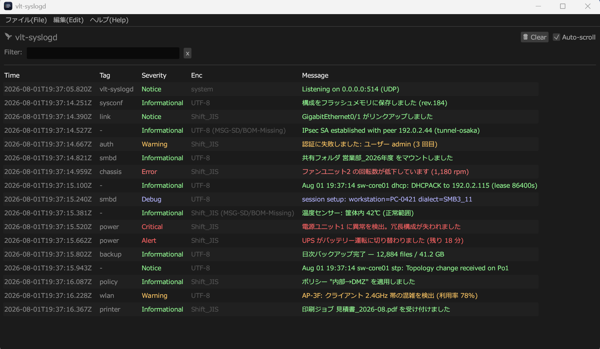

# Veltrea Syslog Server

[English](README.md) · [日本語](README.ja.md) · [한국어](README.ko.md) · [简体中文](README.zh.md) · 繁體中文 · [Tiếng Việt](README.vi.md)

**每一則訊息各自判定 Shift_JIS 或 UTF-8 再解碼。同一個連接埠上編碼混在一起，也不會變成亂碼。**

**[網站（English）](https://veltrea.github.io/vlt-syslogd/index.en.html)** · [日本語](https://veltrea.github.io/vlt-syslogd/) · **[發行版 v0.4.0](https://github.com/veltrea/vlt-syslogd/releases/tag/v0.4.0)**



*與網站上的是同一張圖：v0.4.0 的 Windows 組建。Enc 欄是這一列的判定，會出現 `UTF-8`、`Shift_JIS`，以及 RFC 5424 結構化資料宣告了字元集時的 `Shift_JIS (MSG-SD/BOM-Missing)`。在訊息上按右鍵，選 **Copy as Hex**，就能把原始位元組複製成十六進位。*

最新發行版是 **v0.4.0**，供 Windows、macOS 與 Linux（x86_64）使用。不確定要哪一個檔案時，從 **Portable** 開始。

視窗裡的文字是日文。Windows 與 Linux 的選單寫成 `ファイル(File)`、`編集(Edit)`、`ヘルプ(Help)`。

## 三種形態

讀取 syslog 的想法相同，差別只在怎麼執行。

| | Portable | Server | Console |
|---|---|---|---|
| 二進位檔 | `vlt-syslogd-portable` | `vlt-syslogd-srv` | `vlt-syslogd-console` |
| 是什麼 | 自己打開 UDP 插座的 GUI。不必安裝，也不必登錄服務。 | 沒有畫面的引擎。以 Windows 服務、launchd LaunchDaemon 或 systemd 執行。開機就接收，並寫入磁碟。 | 以 TCP 接到正在執行的 Server 的 GUI。關掉視窗，收集並不停止。服務的啟動、停止與重新啟動也在這個視窗裡。 |
| 連接埠 | UDP，預設 `0.0.0.0:514` | UDP `514`（syslog）。TCP `5141`（送給 Console 的串流）與 TCP `5142`（控制）預設綁在 `127.0.0.1` | 連到 Server 的串流位址與控制位址 |
| v0.4.0 的發布檔 | Windows、macOS、Linux x86_64 | Windows、macOS。Linux 需從原始碼組建（儲存庫裡有 `Server/install-linux.sh`；此發行版沒有 Linux 的 Server 二進位檔） | Windows、macOS。Linux 需從原始碼組建 |

**App** 與 **Portable** 是同一個 GUI，只是資料放的位置不同。

| 形態 | 資料目錄 |
|---|---|
| **App** | Windows 為 `%APPDATA%\vlt-syslogd`，macOS 為 `~/Library/Application Support/vlt-syslogd`，Linux 為 `$XDG_DATA_HOME/vlt-syslogd` 或 `~/.local/share/vlt-syslogd` |
| **Portable** | 執行檔旁邊。macOS 上在 `.app` 旁邊（放進 USB 隨身碟帶走，不寫進系統） |

兩種形態都認 `VLT_SYSLOGD_DATA_DIR`。Server 則使用系統目錄：`C:\ProgramData\vlt-syslogd`、`/usr/local/var/vlt-syslogd` 或 `/var/lib/vlt-syslogd`。

偏好設定（**ファイル → 環境設定…**）只有兩項：監聽連接埠（**待ち受けポート**）與紀錄目錄（**ログ保存先**）。按 **適用** 寫入。

## 下載 v0.4.0，送出一則訊息

下面的檔案是 [v0.4.0 的發行資產](https://github.com/veltrea/vlt-syslogd/releases/tag/v0.4.0)。測試訊息送到紀錄第一列寫出的連接埠。出現 `Listening on 0.0.0.0:514 (UDP)` 表示該連接埠已打開。

要常駐，或從其他裝置接收，見[安裝指南](DOCS/INSTALL.md)。

### Windows

| 形態 | 檔案 |
|---|---|
| Portable | [vlt-syslogd-portable-windows-v0.4.0.zip](https://github.com/veltrea/vlt-syslogd/releases/download/v0.4.0/vlt-syslogd-portable-windows-v0.4.0.zip) → `vlt-syslogd-portable.exe` |
| App | [vlt-syslogd-app-windows-v0.4.0.zip](https://github.com/veltrea/vlt-syslogd/releases/download/v0.4.0/vlt-syslogd-app-windows-v0.4.0.zip) → `vlt-syslogd-windows-x86_64-app-v0.4.0.exe` |
| Server | [vlt-syslogd-srv-windows-v0.4.0.zip](https://github.com/veltrea/vlt-syslogd/releases/download/v0.4.0/vlt-syslogd-srv-windows-v0.4.0.zip) → `vlt-syslogd-srv.exe` 以及 `install-windows.ps1` |
| Console | [vlt-syslogd-console-windows-v0.4.0.zip](https://github.com/veltrea/vlt-syslogd/releases/download/v0.4.0/vlt-syslogd-console-windows-v0.4.0.zip) → `vlt-syslogd-console.exe` |

解壓縮後雙擊 Portable 的 exe。若出現 SmartScreen，選 **更多資訊**，再選 **仍要執行**。繫結 UDP 514 不需要系統管理員權限。

```powershell
$u = New-Object System.Net.Sockets.UdpClient
$b = [Text.Encoding]::UTF8.GetBytes('<132>auth: 認証に失敗しました')
$u.Send($b, $b.Length, '127.0.0.1', 514) | Out-Null; $u.Close()
```

多出一列就表示送到了。這段正文是不帶 BOM 的 UTF-8，正是這個程式常見的輸入。

### macOS

| 形態 | 檔案 |
|---|---|
| Portable | [vlt-syslogd-macos-portable-v0.4.0.dmg](https://github.com/veltrea/vlt-syslogd/releases/download/v0.4.0/vlt-syslogd-macos-portable-v0.4.0.dmg) 或 [.zip](https://github.com/veltrea/vlt-syslogd/releases/download/v0.4.0/vlt-syslogd-macos-portable-v0.4.0.zip) → `vlt-syslogd-portable.app` |
| App | [vlt-syslogd-macos-app-v0.4.0.dmg](https://github.com/veltrea/vlt-syslogd/releases/download/v0.4.0/vlt-syslogd-macos-app-v0.4.0.dmg) 或 [.zip](https://github.com/veltrea/vlt-syslogd/releases/download/v0.4.0/vlt-syslogd-macos-app-v0.4.0.zip) → `vlt-syslogd.app` |
| Server | [vlt-syslogd-srv-macos-v0.4.0.tar.gz](https://github.com/veltrea/vlt-syslogd/releases/download/v0.4.0/vlt-syslogd-srv-macos-v0.4.0.tar.gz) → `vlt-syslogd-srv` 以及 `install-macos.sh` |
| Console | [vlt-syslogd-console-macos-app-v0.4.0.zip](https://github.com/veltrea/vlt-syslogd/releases/download/v0.4.0/vlt-syslogd-console-macos-app-v0.4.0.zip) → `vlt-syslogd-console.app` |

這些組建是 ad-hoc 簽署，沒有公證。下載的應用程式會被 Gatekeeper 加上隔離屬性。清一次，或在應用程式上按右鍵選擇 **打開**。

```bash
xattr -dr com.apple.quarantine vlt-syslogd-portable.app
```

Portable 把資料放在 `.app` 旁邊。隔離屬性還在時，App Translocation 會讓應用程式看不到那個資料夾。CJK 字型使用 macOS 內建的冬青黑體（Hiragino）。

```bash
printf '<34>Oct 11 22:14:15 myhost myapp: hello' | nc -u -w1 127.0.0.1 514
```

macOS 的 `logger` 寫入本機系統紀錄，不能指定主機與 UDP 連接埠。這裡用 `nc`。先看[連接埠 514](#連接埠-514)，再認定 514 已經打開。

### Linux（x86_64）

這個發行版裡只有 GUI。沒有預先組建的 Server 或 Console。需要的話從原始碼組建（[BUILD.md](DOCS/BUILD.md)、[INSTALL.linux.md](DOCS/INSTALL.linux.md)）。

| 形態 | 檔案 |
|---|---|
| Portable | [vlt-syslogd-linux-x86_64-portable-v0.4.0](https://github.com/veltrea/vlt-syslogd/releases/download/v0.4.0/vlt-syslogd-linux-x86_64-portable-v0.4.0) |
| App | [vlt-syslogd-linux-x86_64-app-v0.4.0](https://github.com/veltrea/vlt-syslogd/releases/download/v0.4.0/vlt-syslogd-linux-x86_64-app-v0.4.0) |

它們是動態連結的 x86_64 ELF。打開視窗需要顯示器（X11 或 Wayland）。v0.4.0 的發行說明也把 OpenGL 列為需要的條件。

```bash
chmod +x vlt-syslogd-linux-x86_64-portable-v0.4.0
./vlt-syslogd-linux-x86_64-portable-v0.4.0
```

```bash
printf '<34>Oct 11 22:14:15 myhost myapp: hello' | nc -u -w1 127.0.0.1 514
```

util-linux 的 `logger` 可以送 UDP。macOS 的 `logger` 沒有這組參數。下面是 Linux 上的寫法。

```bash
logger -n 127.0.0.1 -P 514 -d 'hello from logger'
```

要顯示日文，需要 GUI 會去找的 CJK 字型：Noto Sans CJK（`/usr/share/fonts` 下的 `NotoSansCJK-Regular.ttc`）或 IPA Gothic（`/usr/share/fonts/opentype/ipafont-gothic/ipag.ttf`）。否則這些字形會變成 □。Debian / Ubuntu 的 `fonts-noto-cjk` 會把 Noto 放到其中第一條路徑。

## 事先說明

### 連接埠 514

紀錄第一列就是 bind 的結果。出現失敗列時，插座還沒打開，送到 514 的測試訊息不會顯示。

- **Windows。** 繫結 UDP 514 不需要系統管理員。安裝程式只在登錄服務時才要求系統管理員。
- **Linux。** 1024 以下的連接埠需要 root 或 `CAP_NET_BIND_SERVICE`。對 Portable 二進位檔可以這樣：

  ```bash
  sudo setcap 'cap_net_bind_service=+ep' ./vlt-syslogd-linux-x86_64-portable-v0.4.0
  ```

  `Server/install-linux.sh` 安裝的 systemd 單元以 root 執行。單元檔裡有一段註解掉的、改用 `AmbientCapabilities=CAP_NET_BIND_SERVICE` 的例子。
- **macOS。** [DOCS/portable_macos_port_behavior.md](DOCS/portable_macos_port_behavior.md) 記錄了一次非 root 繫結 `0.0.0.0:514` 得到 `EACCES`。應用程式裡的提示仍然寫著：在 macOS 上做萬用繫結不需要 root。以紀錄第一列為準。

bind 失敗時，橫幅會預先填上 **5514**。**待ち受け開始** 只在這次工作階段監聽該連接埠，並不儲存。要留下來，打開 **環境設定** 再按 **適用**，或用 `VLT_SYSLOGD_BIND=0.0.0.0:5514` 啟動。測試訊息送到紀錄列寫出的連接埠。要在 macOS 上佔用 514 本身，請用系統管理員權限啟動 Portable，或安裝以 root LaunchDaemon 執行的 Server（`com.veltrea.vlt-syslogd-srv`）。

### macOS 的 Gatekeeper

這些組建背後沒有 Apple Developer 帳號。右鍵 → **打開**，或按上面的方法去掉 `com.apple.quarantine` 之前，第一次啟動會被攔住。

### 服務在跑，連接埠仍可能到不了

其他裝置要送得到，`bind_addr` 須是 `0.0.0.0` 或區域網路位址，而且防火牆放行 UDP 514。串流（`5141`）與控制（`5142`）在你改掉之前留在迴路位址上。把這兩個埠暴露到本機之外，也就暴露了可以改寫 Server 設定的 `set_config`。安裝指南建議遠端 Console 走 SSH 隧道。

```powershell
# Windows，提高權限後的 PowerShell
New-NetFirewallRule -DisplayName "vlt-syslogd 514/udp" -Direction Inbound -Protocol UDP -LocalPort 514 -Action Allow
```

```bash
# Linux
sudo ufw allow 514/udp
# firewalld：
sudo firewall-cmd --permanent --add-port=514/udp && sudo firewall-cmd --reload
```

macOS 的應用程式防火牆依應用程式過濾。出現提示時，允許 `vlt-syslogd-srv` 的傳入連線。

## 背景

作者長期使用的那些輕量 Windows syslog 伺服器顯示不好日文，於是用 Rust 從頭寫了這個。每個資料報單獨解碼：BOM、RFC 5424 結構化資料裡的 `charset`，或是位元組本身（包括用 `chardetng` 對 Shift_JIS 的估計）。Enc 欄就是這次判定。維護會在體力與精力允許的時候繼續。作者是 veltrea。

## 文件

| | |
|---|---|
| 安裝 | [INSTALL.md](DOCS/INSTALL.md) — [Windows](DOCS/INSTALL.windows.md) · [macOS](DOCS/INSTALL.macos.md) · [Linux](DOCS/INSTALL.linux.md) |
| 連接埠與服務名稱 | [REFERENCE.md](DOCS/REFERENCE.md) |
| 組建 | [BUILD.md](DOCS/BUILD.md) — `cargo build --release --workspace`（edition 2024） |
| 編碼筆記 | [syslog_verification_report.tw.md](DOCS/syslog_verification_report.tw.md) |

## 授權

[MIT](LICENSE)。Copyright (c) 2026 veltrea。
